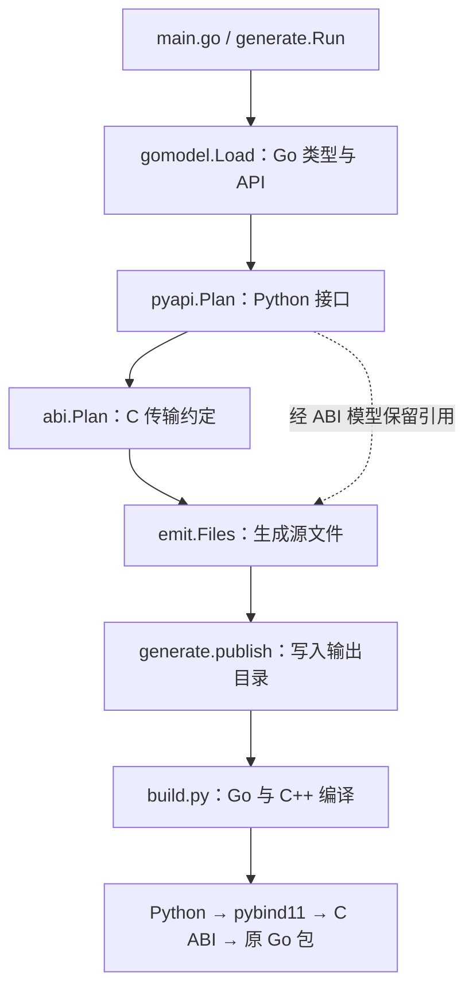

# 生成器分工与设计

[文档导航](README.md) · [模型细节](generator-models.md) · [实例追踪](generator-walkthrough.md)

## 两条执行链

生成器运行时读取 Go 包、规划接口并输出源文件。Python 用户调用时，执行的是编译后
的扩展和 Go 动态库，生成器程序不参与调用。

真实的调用顺序集中在 [generate.Run](../internal/generate/generate.go)。虽然 Python
产物只依赖 `pyapi.Package`，当前 `emit.Files` 在 ABI 规划成功后统一生成所有产物，
没有单独“先写 `.pyi` 再继续”的发布步骤。

## 模块职责

| 模块 | 主要入口与数据 | 负责的决定 |
| --- | --- | --- |
| [main.go](../main.go) | flags → `generate.Config` | 命令行用法、错误输出、退出码 |
| [generate](../internal/generate/generate.go) | `Run`、`checkOutput`、`publish` | 阶段编排、输出目录保护、发布生成文件 |
| [gomodel](../internal/gomodel/load.go) | `Load`、`Analyze` → `gomodel.Package` | 包选择、Go 类型身份、依赖闭包、声明与签名、前端支持域检查 |
| [pyapi](../internal/pyapi/model.go) | `Plan` → `pyapi.Package` | Python 类型映射、用户可见名字、参数名、冲突诊断、当前后端能力门槛 |
| [abi](../internal/abi/model.go) | `Plan`、`wireType` → `abi.Package` | C 类型、位宽、操作符号、结果结构的协议 |
| [emit](../internal/emit/emit.go) | `Files` → `map[string][]byte` | 将模型渲染成 Go、C++、Python 和构建文件 |
| [构建模板](../internal/emit/templates/build.py) | 生成项目中的 `build.py` | 编译 Go 共享库、编译扩展、组装可导入 package |

例如 `HTTPServer` 变成 `http_server` 属于 pyapi；`uint16` 使用 `uint16_t` 属于 ABI；
`uint16_t` 如何用 C++ 模板转换属于运行时实现；输出目录是否为空属于 generate。
按这种边界拆分，修改一条命名规则不需要同时编辑 Go 和 C++ 的字符串拼接。

## 三份模型保留不同信息

Go 模型保留语言中的类型身份；Python 模型描述用户会看到的接口；ABI 模型确定动态库
边界上的表示。比如 `int8` 与 `int64` 在 Python 中都写为 `int`，但 ABI 必须继续知道
它们的位宽，所以 Python 类型节点保留指向 Go 类型节点的引用。

这些模型是生成器进程内的结构体和图，不是生成文件的解析结果，也不是持久化格式。
当前引用方向是 `abi → pyapi → gomodel`。生成器不会读回 `.pyi` 来推导 C++ 签名。
详见[模型与类型闭包](generator-models.md)。

## 输出器按产物拆分

| 文件 | 关键函数 | 输出 |
| --- | --- | --- |
| [emit.go](../internal/emit/emit.go) | `Files`、`buildConfig` | 文件清单、Go 格式化、`bridge.json`、生成项目 README |
| [adapter.go](../internal/emit/adapter.go) | `goSource`、`goOperation`、`goInput`、`goOutput` | Go cgo 导出与传输转换；不捕获 panic |
| [bindings.go](../internal/emit/bindings.go) | `cppSource`、`cppOwner`、`cppFunction`、`cppInput`、`cppOutput` | pybind11 注册、C 调用、结果所有权 |
| [python.go](../internal/emit/python.go) | `stubSource`、`returnAnnotation`、`pythonSource` | `.pyi` 与 Python 公开导出 |
| [runtime.cpp.tmpl](../internal/emit/templates/runtime.cpp.tmpl) | `integer_arg`、`string_arg`、`decode` 等 | 所有绑定共用的 C++ 转换代码 |

模板由 `go:embed` 放入生成器，再写入产物。`build.py` 原样复制；C++ 运行时拼入
`bindings.cpp`；Go 运行时当前是 `adapter.go` 内的 `adapterRuntime` 常量。这些模板
无需在运行时访问生成器源码目录。

输出器仍要根据 ABI `Kind` 选择具体转换代码。它们执行约定，不应重新计算 Go 方法集、
决定 Python 名字或在遇到不支持类型时悄悄跳过声明。

## 生成与构建分离

`emit.Files` 先把全部源文件放入内存，随后 `publish` 在目标目录旁写临时目录并重命名。
已有空目录会先移除再发布；非空目录、文件、符号链接会被拒绝。生成失败不会暴露半套
源文件，但这不是支持多写入者并发操作同一输出路径的事务系统。

生成项目仍依赖原始 Go 源码。`bridge.json.source_dir` 决定构建工作目录，让原 module、
workspace 和 replace 规则继续生效；`package` 决定 Python 包名和库名。`import_path`
目前仅记录来源，`build.py` 没有使用它重新解析目标包。

构建步骤依次产生 Go 动态库和 cgo 头文件，再编译使用该头文件的 C++ 扩展，最后将
扩展、动态库和 Python 文件放在 `.build/python/<包名>/`。构建过程直接更新 `.build`，
不具有生成源码发布时的整体重命名保证。

## 当前边界与后续设计

目前完整链路只覆盖基础值函数。Go 前端已经识别 named、slice、struct 和指针，但
`pyapi.basicName` 会拒绝非 Basic 节点。生成器中尚无 holder、Ref 包装类或句柄传输。

后续生成的包装类仍放 C++，通过 pybind11 暴露；Python `__init__.py` 主要重新导出。
struct 的 `addr()`、视图、指针类以及 slice 操作要先进入接口/ABI 模型，再扩展输出器。
这些是[实施计划](generator-plan.md)中的任务，不是当前输出器已经具备的通用能力。
